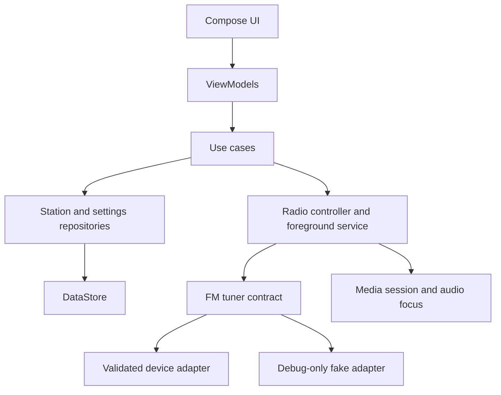

# FM Radio — Project specification

Version 1.0 | Development baseline | Open-source Android application

## 1. Vision
Build a minimalist Android application that receives terrestrial FM broadcasts through the phone's native tuner, without root, Internet streaming, or privileged installation. Kotlin is the primary language. Listening must work in airplane mode when the device permits FM reception. Optional online features are future extensions, not MVP dependencies.

## 2. Scope and constraints
- Minimum SDK: 26 (Android 8). Compile and target a current stable SDK compatible with the selected build tools; pin versions in the repository.
- Distribution: signed APKs and GitHub releases. Open-source license to be approved (Apache-2.0 proposed).
- Primary device: Realme 10 Pro, whose original FM app works according to the user. Secondary: Realme 7, whose original FM app is absent. Exact RMX model, region, OS build and firmware are unknown.
- Standard third-party app permissions only. No root, system signing, privilege escalation, modified firmware or hidden-API enforcement bypass. Investigate alternative approaches, but do not ship approaches that violate this constraint.
- Android has no universal public phone FM tuner API. API 26 support is an application baseline, not a guarantee of tuner support.

## 3. Phase 0 — mandatory hardware feasibility gate
Before investing in the full UI, establish whether an ordinary APK can independently tune and hear FM on the Realme 10 Pro.

1. Record exact model, Android version, build fingerprint, region and antenna requirements. Verify the stock app receives real terrestrial FM with network disabled.
2. Use authorized ADB debugging to inspect installed packages, declared permissions, exported components, system features and accessible service information. Example commands: `adb shell getprop ro.product.model`, `adb shell getprop ro.build.fingerprint`, `adb shell pm list packages`, `adb shell dumpsys package PACKAGE_NAME`, `adb shell service list`. Shell visibility does not establish APK access.
3. Investigate documented OEM SDKs, explicitly exported and authorized vendor services, and existing open-source FM implementations for the exact chipset and firmware. Review licensing before reuse.
4. Investigate AOSP broadcast radio interfaces as research only: they are commonly system/automotive interfaces, not a public handset tuner API. JNI/NDK may wrap an accessible vendor interface but cannot grant missing permissions or bypass SELinux. Direct device nodes, private HALs and signature permissions are likely blockers. Launching the stock app via an exported intent is not independent tuner control.
5. Build a minimal debug APK with ordinary app identity. Attempt open, tune to a known local station, audible output, retune and release. Test with wired antenna connected and disconnected, network off, and after restarting the app. Record actual errors and logs. Verify that no stock app UI, ADB shell privilege or Internet stream is responsible for playback.
6. Repeat on Realme 7 only after documenting the primary result. Absence of a stock app is not proof of missing hardware.

### Gate outcome
PASS: at least one device/firmware combination provides repeatable independent tuning and audible FM with an ordinary APK. Record supported operations and proceed to hardware MVP.
BLOCKED: no permitted interface works. Document the reason; do not claim real FM support. Continue only with a clearly labeled mock/demo or reconsider target devices with user approval. Do not silently substitute Internet radio.

Compatibility matrix (initial):

| Device | Stock app | Third-party access | Status |
|---|---|---|---|
| Realme 10 Pro | Works (user report) | Unknown | Primary investigation |
| Realme 7 | Absent (user report) | Unknown | Secondary investigation |

Maintain `docs/compatibility.md` with exact firmware, adapter, antenna, tuning, seek, signal, RDS, audio routes, stereo, background and test date. Unknown is distinct from unsupported.

## 4. Functional requirements

Priorities: P0 = essential MVP; P1 = requested enhancement after basic MVP, or hardware-dependent capability. All listed features remain in the project scope; unsupported operations must be explained rather than simulated in production.

| ID | Requirement | Priority |
|---|---|---|
| FR01 | Detect accessible tuner and report compatibility | P0 |
| FR02 | Start/stop real FM playback | P0 |
| FR03 | Frequency slider, manual entry, step up/down | P0 |
| FR04 | Regional frequency band and channel spacing | P0 |
| FR05 | Seek previous/next station | P1 |
| FR06 | Automatic scan with progress and cancellation | P1 |
| FR07 | Signal strength indicator using actual measurements | P1 |
| FR08 | Save, rename and remove favourites | P0 |
| FR09 | Display RDS station name when available | P1 |
| FR10 | Recently listened stations | P1 |
| FR11 | Volume and mute/unmute | P0 |
| FR12 | Wired playback and antenna status where detectable | P0 |
| FR13 | Speaker and Bluetooth routing | P1 |
| FR14 | Mono/stereo switching | P1 |
| FR15 | Background and screen-off playback | P0 |
| FR16 | Notification and lock-screen controls | P0 |
| FR17 | Pause or stop on call/audio interruption; conditional resume | P0 |
| FR18 | Sleep timer | P1 |
| FR19 | Light/dark/system themes and extensible localization | P0 |
| FR20 | Hardware diagnostics screen | P0 |

### Use cases and business rules
- Start: check capabilities and antenna prerequisites; acquire tuner, tune last valid frequency (or band default), confirm audio before showing Playing. Stop releases tuner, audio focus and service resources.
- Tune: represent frequency as integer kHz, never floating-point storage. Validate band bounds and channel grid. Reject invalid manual input with explanation. Slider snaps to valid channels; debounce drag updates and commit final selection. At band edge stop stepping (no wrap in MVP).
- Seek: search for next/previous receivable station using hardware seek when available. A bounded software search is permitted only with reliable signal/lock metrics. Stop at band edge; no infinite search. Cancel on stop or conflicting command.
- Scan: enumerate valid channels or use native scan; report progress if measurable, deduplicate by band and frequency, allow cancellation, restore prior tuned frequency on completion/cancel. Never fabricate stations or infer reception solely from successful tuning.
- Favourites: unique by band ID and frequency. Custom names take precedence over RDS names; frequency is fallback. Changing region retains favourites but disables incompatible ones until region is restored.
- RDS: associate metadata with current tuning session; clear stale metadata on retune. Missing RDS does not prevent playback.
- History: record successfully played stations, newest first, deduplicate and cap at 50 entries (proposed default). No history entry for scan-only tuning.
- Audio: use system media volume where applicable; mute without losing tuned frequency when supported. Do not assume tuner audio is PCM or routed through Android's ordinary media stream. Show actual supported routes and stereo capabilities. Bluetooth headphones do not replace a wired antenna unless verified.
- Interruptions: respect audio focus and system call behavior. Resume only after transient interruption ends, focus is regained, prerequisites hold, and user has not stopped playback or let timer expire. Permanent focus loss stops playback. Avoid requesting call-log or phone-state permissions merely for interruption handling.
- Sleep timer: proposed presets 15/30/60/90 minutes plus cancel. Use monotonic elapsed time while service runs; expiry stops and releases radio. Do not restart playback after process death to restore a timer.

## 5. Regional configuration
Default proposed international profile: 87,500–108,000 kHz, 100 kHz step. Validate against target region and adapter capabilities before enabling. Other profiles may use different bounds, grid origins, spacing and deemphasis. A profile must contain ID, localized name, min/max kHz, grid origin, step kHz and optional deemphasis. Valid channels satisfy bounds and `(frequency - gridOrigin) % step == 0`. Only expose profiles supported by the adapter; do not claim hardware deemphasis control without evidence. Display MHz using localized formatting and sufficient decimal precision.

## 6. UX specification

Navigation: bottom navigation for Player, Stations and Favourites; Settings accessible from top bar; Diagnostics accessible from Settings. Proposed layout, not a fixed visual design.

### Player
- Large frequency display, station name, actual signal indicator (or unavailable label).
- Frequency slider, step buttons, distinct seek buttons, editable frequency, play/stop, favourite toggle, volume/mute.
- Route and stereo controls only when supported; sleep timer shortcut.
- Clear antenna, unsupported device and playback error messages. No fake signal bars.

### Available stations
Scan action, progress, cancel, results with frequency and available names; tap to tune; favourite action. Empty and unsupported states are distinct.

### Favourites
Saved stations with custom/RDS names, frequency, tune, rename and remove. Recent stations section may appear here to avoid adding a screen.

### Settings
Region, system/light/dark theme, language (when translations exist), history clearing, diagnostics and about/licenses.

### Diagnostics
Model, OS/build, selected adapter, probe result, capability flags, antenna state if observable, last sanitized error and retry. Offer local copy/share of diagnostic text with user consent; no device identifiers or automatic uploads.

Accessibility: 48dp minimum touch targets, TalkBack labels, scalable text, sufficient contrast, accessible slider semantics and no color-only status. Default English strings in Android resources; translations added via locale resources, no hardcoded UI text. Additional launch languages are not specified.

## 7. Technology stack

| Area | Choice |
|---|---|
| Language/build | Kotlin, Gradle Kotlin DSL, version catalog |
| UI | Jetpack Compose, Material 3, Navigation Compose |
| State | ViewModel, StateFlow, Kotlin coroutines |
| Architecture | MVVM with Clean Architecture, single app module initially |
| Persistence | Preferences DataStore with versioned JSON for small lists; Kotlin serialization |
| Dependency injection | Manual constructor injection and application container initially |
| Playback | Foreground service, AndroidX Media3 session integration where feasible |
| Hardware | Kotlin adapter; JNI/NDK only if validated and necessary |
| Tests | JUnit, coroutine test, fakes, Compose UI tests, physical devices |

No backend, cloud database, Room or Hilt required for MVP. Reconsider Room only if storage/query needs grow. Media3 is for media-session integration, not FM reception; use a custom player/session bridge that reports actual tuner state and supported commands.

## 8. Architecture and directory structure

```text
app/src/main/java/<package>/
  presentation/
    player/ stations/ favourites/ settings/ diagnostics/
    navigation/ theme/
  domain/
    model/ repository/ usecase/
  data/
    local/ repository/
  hardware/
    FmTuner.kt
    adapter/ capability/
  playback/
    RadioService.kt
    RadioController.kt
    AudioFocusController.kt
  di/
app/src/main/res/values/strings.xml
app/src/test/
app/src/androidTest/
docs/compatibility.md
docs/hardware-research.md
README.md
PROJECT_SPECIFICATION.md
```

Domain models and repository contracts remain independent of Android UI and vendor APIs. Presentation sends commands through use cases/controller; the playback service owns the tuner session and authoritative state. Data repositories handle persistence. Vendor adapters isolate firmware-specific details. UI must not open a second tuner when recreated. Use a serialized command processor or mutex to prevent tune/scan/stop races. Long operations must be cancellable and run off the main thread. Stale callbacks must be discarded using session/generation identifiers.



## 9. Hardware contract (proposed Kotlin interface)

The following is an interface design, not a working hardware implementation. Define typed results and models before coding adapters.

```kotlin
interface FmTuner {
    val events: Flow<TunerEvent>
    suspend fun probe(): ProbeResult
    suspend fun open(band: FmBand): TunerResult<Unit>
    suspend fun tune(frequencyKhz: Int): TunerResult<Unit>
    suspend fun seek(direction: Direction): TunerResult<Int>
    suspend fun scan(onStation: suspend (Station) -> Unit): TunerResult<Unit>
    suspend fun setMuted(muted: Boolean): TunerResult<Unit>
    suspend fun setRoute(route: AudioRoute): TunerResult<Unit>
    suspend fun setStereoMode(mode: StereoMode): TunerResult<Unit>
    suspend fun close()
}
```

`ProbeResult` distinguishes Supported, Unsupported, PermissionDenied and Unknown/Error. Capabilities include tuning, supported bands, seek, scan, signal, RDS, mute, routes, stereo and antenna detection. Optional operations return typed Unsupported rather than throwing unhandled exceptions. Events include tuned frequency, audio status, signal metric with units, RDS, antenna and errors. `close` is idempotent. Define cancellation behavior and timeouts per adapter; do not assume a hardware scan can always be interrupted instantly. A fake adapter is debug/test only, with visible Demo labeling; production must never silently use it.

### State model
Idle → Opening → Tuning → Playing; Playing may transition to Seeking, Scanning or Interrupted; operations return to Playing or Idle as appropriate. Stopping releases resources; failures enter Error with a recoverable action where possible. Unsupported is a separate terminal compatibility state until reprobe. Muted is a property of an active session, not a separate tuner owner. UI state includes confirmed frequency, pending frequency, capabilities, actual audio status, metadata, route, timer deadline and last error.

## 10. Local data model

| Model | Fields |
|---|---|
| FmBand | id, minKhz, maxKhz, gridOriginKhz, stepKhz, optional deemphasis |
| Station | bandId, frequencyKhz, optional rdsName, optional signal metric |
| Favourite | bandId, frequencyKhz, customName?, lastKnownRdsName?, createdAt |
| RecentStation | bandId, frequencyKhz, lastKnownName?, lastPlayedAt |
| Settings | regionId, themeMode, languageTag?, lastFrequencyByBand, schemaVersion |

Persist favourites, history and settings atomically using DataStore updates. Keep scan results and live signal in memory for MVP. Store timestamps as epoch milliseconds; use monotonic time for timer durations. Validate corrupted or obsolete data, migrate schemas and avoid overwriting recoverable data without warning. No account, remote sync or personal identifiers.

## 11. Background playback and permissions

Start foreground playback from a visible user action, not arbitrary background launches. Use mediaPlayback foreground service type and the applicable manifest permissions (`FOREGROUND_SERVICE`, `FOREGROUND_SERVICE_MEDIA_PLAYBACK` on relevant versions). Create a notification channel on API 26+. Follow foreground-service startup deadlines and current target-SDK restrictions, including audio focus eligibility on newer Android. Integrate media session with actual play/stop state, previous/next seek where supported and system lock-screen controls where exposed by OS. Request `POST_NOTIFICATIONS` on API 33+ only as appropriate; media-session notification exemptions and user/system settings affect visibility. Do not assume lock-screen controls are guaranteed.

Use `AudioManager` audio focus APIs; test transient/permanent loss, ducking (pause if ducking is unavailable), wired unplug and noisy-route events. If a hardware path cannot reliably pause or mute, stop and reacquire only when safe. Bluetooth routing may require version-specific permissions if directly interacting with Bluetooth APIs; avoid those permissions if system routing suffices. Do not request microphone, location, contacts, storage or Internet permission for core FM. Add wake locks only if testing proves necessary, release promptly, and declare permission if used. Do not request battery optimization exemptions by default. Stop foreground service when playback ends; no automatic boot or process-death playback restart.

## 12. Error handling and non-functional requirements

Typed errors: tuner unavailable, access denied, antenna required, busy, invalid frequency, unsupported operation, timeout, route unavailable, audio focus denied, hardware disconnected, unexpected failure. Show actionable localized messages, retain favourites and release resources on failure. Retry only on user request or bounded recovery where safe. Do not report missing hardware when access is merely denied.

- Offline: no network dependency or telemetry in MVP.
- Responsiveness: no blocking hardware or disk work on UI thread; immediate command feedback, bounded timeouts calibrated on real devices.
- Reliability: no leaked tuner handles, service, audio focus or wake locks; handle rotation, process death and repeated start/stop.
- Efficiency: event-driven state updates, avoid continuous polling when idle; measure battery usage on physical devices rather than inventing targets.
- Privacy: local-only data, sanitized logs, explicit diagnostics sharing.
- Maintainability: adapter-specific code isolated, documented interfaces, reproducible builds and tests.

## 13. Acceptance criteria and testing

| Test | Pass condition |
|---|---|
| Real reception | Known station audible with network off from ordinary APK, not stock app delegation |
| Tuning | Valid frequency confirmed; invalid/off-grid frequency rejected; step respects bounds |
| Favourites | Save, rename, remove and restore after app restart |
| Background | Playback continues while minimized and screen locked on supported firmware |
| Controls | Notification commands and supported lock-screen controls reflect actual state |
| Interruptions | Audio stops/pauses on focus loss; no unwanted resume after explicit stop |
| Unsupported device | Clear diagnostic state, no crash or fake playback |
| Resource cleanup | Repeated start/stop releases tuner and focus; stock radio can subsequently acquire tuner |
| Scan/seek (P1) | Real stations, bounded search, cancellation, no duplicate scan results |
| RDS/signal (P1) | Real metadata/metrics or explicit unavailable state |
| Routing/stereo (P1) | Verified audible output or disabled unsupported control |
| Timer (P1) | Stops playback and releases resources at expiry |
| Localization/theme | System theme and translated resources render without clipping |

Unit tests: frequency grid, band validation, favourite uniqueness, name precedence, history limit, timer and interruption state machine. Integration tests: fake adapter event ordering, cancellation, DataStore persistence, service lifecycle. Compose tests: navigation, invalid input, unsupported and error states, accessibility. Physical tests: both target devices, exact firmware recorded; antenna unplug, Bluetooth, speaker, incoming call, airplane mode, screen lock, competing radio app, process kill and reboot. Emulator validates UI and mock logic only, not real FM.

## 14. Implementation roadmap

- Phase 0: hardware research, minimal probe APK, compatibility evidence and go/no-go decision.
- Phase 1: Gradle project, domain models, adapter contract, debug fake, persistence and Compose navigation; unit tests.
- Phase 2: integrate validated hardware adapter, player, manual tuning, favourites, diagnostics and basic audio; verify real offline reception.
- Phase 3: foreground playback, media session, interruptions, themes and localization; complete P0 acceptance tests. This is the minimal functional MVP release gate.
- Phase 4: requested P1 enhancements (scan, seek, signal, RDS, history, routes, stereo, timer), each gated by capability and tests. Release incrementally.
- Phase 5: expand verified device support and optional online features only after separate requirements approval.

## 15. Release and repository guidelines
Use Git, small reviewed commits, README with installation and exact verified device list, contribution guide, approved license, third-party notices and issue templates for compatibility reports. GitHub Actions may run lint, unit tests and debug builds; physical hardware checks remain manual unless a real-device test setup exists. Keep signing keys outside repository; use a stable release key, versionCode/versionName and publish APK checksum with release notes. Do not advertise support for untested firmware. Review vendor library redistribution rights before bundling binaries.

## 16. Instructions for a development agent
1. Read this specification and hardware research before choosing libraries. Start with Phase 0, not a fabricated generic FM API.
2. Never invent vendor classes, permissions, device nodes or successful hardware results. Cite source code/docs and record actual test evidence.
3. Keep ordinary APK access as a hard constraint. If blocked, report the blocker and ask before changing scope.
4. Implement one phase at a time with tests, build instructions and a summary of changed files. Keep fake and real adapters separate.
5. Use capability-driven UI, typed failures, structured concurrency and a single tuner owner. Do not implement streaming as a substitute.
6. Pin dependencies, check API 26 compatibility, avoid unnecessary permissions and document deviations.
7. Mark a requirement complete only after its acceptance criteria are met; distinguish emulator tests from physical tests.

## 17. References for implementation research
Starting points (not evidence of Realme compatibility; links not live-verified in this specification):
- Android broadcast radio architecture: https://source.android.com/docs/automotive/radio
- Android foreground services: https://developer.android.com/develop/background-work/services/fgs
- Media3 background playback: https://developer.android.com/media/media3/session/background-playback
- Audio focus: https://developer.android.com/media/optimize/audio-focus
- DataStore: https://developer.android.com/topic/libraries/architecture/datastore
- Android app architecture: https://developer.android.com/topic/architecture

## 18. Decisions and unresolved items
User-confirmed: Kotlin, Compose, MVVM/Clean Architecture, API 26, non-root, open source, offline-first, simple storage, requested features, APK/GitHub distribution and two target phones.

Proposed decisions requiring review: primary device order, P0/P1 split to keep MVP minimal, Material 3, DataStore JSON, manual DI, single module, default band and spacing, English base resources, history limit, timer presets, navigation, Apache-2.0 license and no network permission in MVP. Project/package name, exact firmware, initial translations, regional profiles and license remain open.

Critical blocker: no third-party FM access has been demonstrated on either device. This document is a development guideline, not a compatibility certification or tested implementation. Audio routing, RDS, signal, stereo and background behavior depend on the validated adapter and firmware. No physical tests or live vendor documentation verification were performed in preparing this specification.
